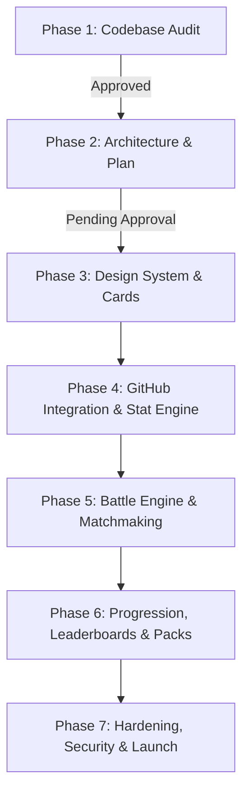

# GitFC: Execution Plan & Roadmap (Phase 2)

**Version:** 1.0.0  
**Status:** Complete — Awaiting Approval  

---

## 1. Phased Task Breakdown & Estimates

### Phase 3: Design System, UI Shell & Card System
- **Tasks**:
  1. Define design tokens (`src/styles/tokens.ts`) for all 5 rarities (borders, glows, typography, foil textures) with color-blind safe identifiers and `prefers-reduced-motion` support.
  2. Refactor `EAFCCard.tsx` into responsive `CardView.tsx` supporting Developer, Repository, and Language card types with stat breakdown popovers.
  3. Build mobile-first navigation shell (bottom navigation bar on mobile, sleek top navbar on desktop) with routes: Home, Battle, Collection, Leaderboard, Profile.
  4. Build high-converting Landing Page with interactive card preview for any public GitHub handle.
- **Acceptance Criteria**:
  - All 5 rarities visually distinguishable without relying solely on color.
  - Zero dead buttons; responsive layout tested at 360px and 1440px.

### Phase 4: GitHub Integration & Card Generation Engine
- **Tasks**:
  1. Implement GitHub GraphQL client with fallback to public snapshot cache.
  2. Author pure, deterministic card generation engine in `src/game/cardGenerator.ts` implementing the 7 core stats with anti-gaming rules.
  3. Set up Neon Postgres schema & Drizzle ORM migrations (`users`, `github_snapshots`, `cards`, `card_instances`).
  4. Write exhaustive Vitest unit tests verifying deterministic output from identical snapshots.
- **Acceptance Criteria**:
  - Minimal OAuth scope (`read:user`) working end-to-end with secure cookies.
  - Identical snapshots generate identical cards with 100% test coverage on formulas.

### Phase 5: Server-Authoritative Battles & Matchmaking
- **Tasks**:
  1. Build 5-card Deck Builder with live budget validation (≤ 415 OVR, max 2 Legendary/Mythic).
  2. Implement server-side battle state machine in `src/game/battleEngine.ts` (round category PRNG seed, secret commitments, ability resolution order, tie-breakers).
  3. Implement `/api/battles/*` routes with transaction-level locking and idempotency constraints.
  4. Create interactive Battle Arena UI: commit phase, simultaneous reveal animation, stat modifier breakdown, and victory screen.
  5. Implement GitFC Training Bot for unranked onboarding.
  6. Build and run the 10,000-match Monte Carlo simulation proving deck strategy overcomes raw rating.
  7. Write cheat-test suite (duplicate cards, foreign card IDs, modifying stat payloads).
- **Acceptance Criteria**:
  - Full Bo3 and Bo5 matches resolve server-side with zero client trust.
  - Hidden-selection rule enforced; all cheat tests pass.

### Phase 6: Progression, Leaderboards, Achievements & Daily Loops
- **Tasks**:
  1. Implement server-side ELO rating calculation with provisional matches and anti-farming dampening.
  2. Create Global, Weekly, and Friends leaderboards with cached queries and deterministic tie-breaking.
  3. Build Daily Pack claim flow with transparent odds, pity timer, and duplicate conversion to soft shards.
  4. Implement Daily Challenges & server-evaluated Achievements.
  5. Build Player Profile and dynamic OG image generation for battles and cards.
- **Acceptance Criteria**:
  - ELO logged in `ratings_history`; daily pack and challenges reset seamlessly across UTC boundaries.
  - Zero fake accounts on production leaderboards.

### Phase 7: Hardening, Security, A11y & Launch Readiness
- **Tasks**:
  1. Run automated WCAG 2.2 AA accessibility audit (axe-core, keyboard navigation across deck builder and battles).
  2. Audit security headers, CSRF protection, rate limiting on all endpoints, and CSP.
  3. Run Lighthouse mobile performance audit (target: LCP < 2.5s, Performance ≥ 90).
  4. Configure production environment variables and deploy migration hooks on Vercel.
  5. Write final deployment guide, documentation, and rollback instructions.

---

## 2. Test Strategy

| Test Suite | Framework | Scope |
|---|---|---|
| **Unit Tests** | **Vitest** | Pure game logic: stat calculations, overall blend, rarity thresholds, ability interactions, tie-breaks, PRNG seeding, ELO updates, deck validation. |
| **Simulation Suite** | **Node.js script** (`scripts/simulate-balance.ts`) | 10,000 automated simulated matches between diverse deck archetypes to prove tactical win rate ≥ 40% against higher-rated decks. |
| **API Integration Tests** | **Vitest + Supertest / HTTP** | Auth guards, session validation, Zod rejection, battle state transitions, idempotency keys, duplicate submissions, and rate limits. |
| **Cheat Test Suite** | **Vitest** | Explicit attacks: submitting foreign card IDs, modified stat values, replaying completed rounds, out-of-turn moves. |
| **E2E & Accessibility** | **Playwright + @axe-core/playwright** | End-to-end player journey: sign in → reveal card → open pack → build deck → battle training bot → view rank. |
